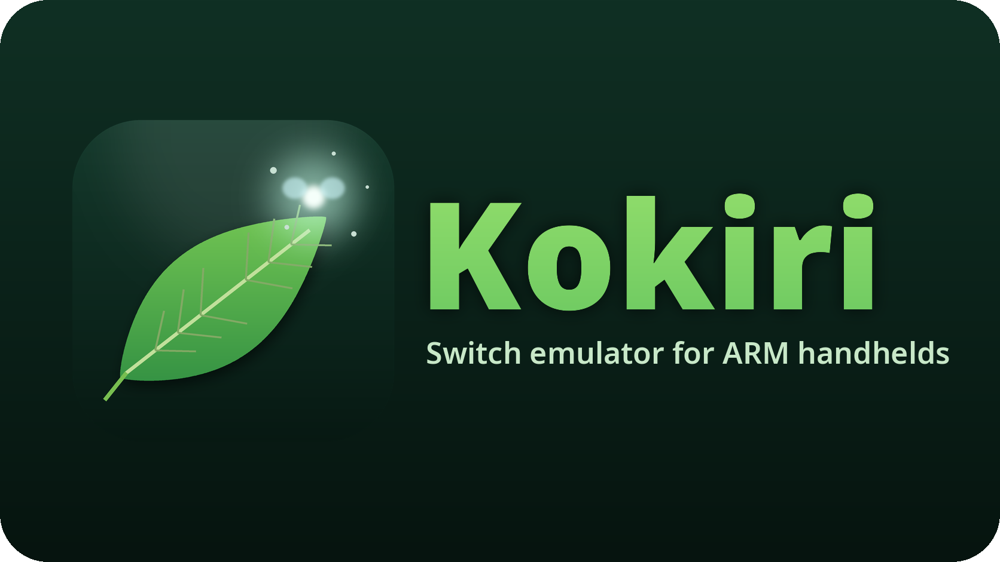

<!--
# SPDX-FileCopyrightText: Copyright 2025 Eden Emulator Project
# SPDX-License-Identifier: GPL-3.0-or-later

# SPDX-FileCopyrightText: 2018 yuzu Emulator Project
# SPDX-License-Identifier: GPL-2.0-or-later
-->

<p align="center">
  
</p>

# Kokiri

**Kokiri** is a Nintendo Switch / Switch 2 emulator fork for **ARM64 handhelds with limited memory and older mobile GPUs**: Linux gaming handhelds and similar devices built on Snapdragon SoCs with Adreno GPUs (Mesa Turnip), with 12 GB of RAM or less.

It builds on [Lichii for Android](https://github.com/pavelgajdo/Lichii-Android) by pavelgajdo, itself a fork of [Lichii](https://github.com/zortos293/Lichii) (Eglantine / Eden / yuzu lineage), and adds the changes those devices need. Like the Kokiri of the forest, it is meant for the small ones.

This is an independent, experimental fork. It is not affiliated with Nintendo or with the upstream projects it builds on. Games, keys and firmware are not included: only use games and system files you have legally obtained.

## Tested on

| | |
|---|---|
| Device | AYN Thor Pro (256 GB storage + 12 GB RAM) |
| SoC | Snapdragon 8 Gen 2 |
| GPU | Adreno 740 (a7xx), Mesa Turnip (Vulkan 1.4) |
| RAM | 12 GB (about 11 GiB usable), zram swap |
| OS | Linux (ArmadaOS, Fedora based), kernel 7.2 |
| CPU backend | NCE |

Other Adreno a6xx/a7xx devices running Linux with Turnip are the intended targets, but only the device above is tested so far.

## What Kokiri changes

On top of Lichii for Android (pavelgajdo, early November 2026 base):

- **Wave64 software tensor math on Adreno a7xx.** Turnip on a7xx cannot run compute at the guest's 32-lane warp size; Kokiri requests 64-lane subgroups and lets one host wave carry two guest warps in the software HMMA emulation. On the Thor this took Ocarina of Time from ~1.5 fps to playable. Optional shared-B path: `EDEN_NX2_HMMA_SHARED_B=1`.
- **Cheaper software matrix B gathers** on guarded Turnip pipelines (NickWalters' Turnip work).
- **Fewer waits on the split GPU thread** (ports of jpkto's Lichii #805 work): command entries wait only for the writers before the last host sync; GPU-written compute list words (Ocarina's culling counts) stay on the host GPU and are dispatched indirectly; greater-or-equal semaphore acquires are decided without draining the split; GPU-written mesh draw arguments are not read on the front (Lichii #980, adapted to GPUs without mesh shaders).
- **No re-upload of 64 KiB native uniform banks on every bind** in Ocarina of Time (thousands of render pass breaks a second on a tiled GPU).
- **128 MiB NUP decompression cache on aarch64** (12 GB devices).
- **Split GPU threads pinned by core speed** on Linux ARM handhelds with mixed cores: the back thread on the fastest cores, the front and the Vulkan worker off the slowest cluster (`EDEN_NX2_PIN=0` turns it off). On the Thor this took a fixed heavy view of Kokiri Forest from 10.3 to 10.9 fps.
- **Lighter back thread** (ports from Frizti's Fritchii PR 24, all on by default): texture upload staging is filled on a separate `TexFill` thread (`EDEN_NX2_TEXTURE_FILL=0` off), a fence's empty second submit is skipped (`EDEN_NX2_SKIP_EMPTY_SUBMITS=0` off), dirty memory is gathered without locks when there is none, and `draw.begin` takes a fast path.
- **Macros that read memory run on the split's back thread** (Lichii #1056, jpkto's #805 back macros, adapted to this base): the front no longer waits for the back on every macro memory read. No frame-rate gain is proven on the Thor yet (heavy views stay around 10 fps).
- **Fixes and improvements from newer Lichii for Android commits**, picked onto this base:
  - suspended channels polled every 50 µs;
  - cheaper ASTC uploads, and no stale guest memory or overwritten uploads in new images;
  - Ocarina of Time image fixes: the noperspective varyings behind the tomb's red line, the movie input copy, render passes kept after a deferred clear, and a larger occlusion query reset cap;
  - Dynamic FPS keeps real game speed down to 10 fps.

  A rebuild on the newer base itself runs correctly (with a GCC 13 fix, sent upstream) but was about 16% slower on the Thor, so Kokiri stays on this base for now.

Investigation notes from the Thor (what limits the frame rate, what was tried and measured) are kept in [docs/kokiri/NOTES.md](docs/kokiri/NOTES.md).

## Game status (AYN Thor Pro)

| Game | Status |
|---|---|
| The Legend of Zelda: Ocarina of Time (Switch 2) | Playable at 0.5x with a warm shader cache: about 16 fps average walking around Kokiri Forest (10–26 fps); fixed views of the forest range from about 10 fps (heaviest) to 24 fps (light). Movies and the intro run full speed. |

## Recommended settings (Ocarina of Time on Adreno)

- **Graphics:** resolution 0.5x, GPU accuracy Low, asynchronous shader building on, disk shader cache on, reactive flushing on.
- **Upscaling:** FSR with 25% sharpening, emulator anti-aliasing off (about 2% slower than ScaleForce + FXAA, with a sharper image).
- **Ocarina of Time anti-aliasing:** *No sharpening* (skips the game's tensor-core sharpening network), with the built-in *Max Resolution* patch enabled.
- **Environment** (launch script): `EDEN_NX2_HMMA_SHARED_B=1`, `EDEN_NX2_ASTC_MAX_DIM=1024`, and on 12 GB devices `EDEN_NX2_VRAM_LIMIT_MIB=3200` (the launch scripts in the releases set these).
- Keep the shader cache between sessions: the first visit to an area compiles pipelines and stutters; after that the area runs at its normal frame rate.

## Building (Linux aarch64)

```bash
cmake -S . -B build -G Ninja -DCMAKE_BUILD_TYPE=Release \
  -DBUILD_TESTING=OFF -DYUZU_TESTS=OFF -DYUZU_CMD=OFF -DYUZU_ROOM=OFF -DYUZU_ROOM_STANDALONE=OFF \
  -DYUZU_USE_BUNDLED_QT=OFF -DYUZU_USE_BUNDLED_SDL3=ON -DENABLE_UPDATE_CHECKER=OFF \
  -DUSE_DISCORD_PRESENCE=OFF -DCMAKE_PREFIX_PATH=/path/to/Qt/6.8.3/gcc_arm64
cmake --build build --target yuzu --parallel 6
```

Builds were made in an Ubuntu 24.04 arm64 container with Qt 6.8.3 (aqtinstall). The binary is `build/bin/lichii`. On a fanless or thermally limited handheld, pause the build when the SoC gets hot.

The Android build from upstream still works as described in the [Lichii for Android README](https://github.com/pavelgajdo/Lichii-Android#building).

## Reporting problems

[Open an issue](https://github.com/leonardomp10/Kokiri/issues) with your device, OS, GPU driver (Mesa version), the game, what happened, and the log (`~/.local/share/eden/log/eden_log.txt` or your profile's `log` folder). Never upload games, keys, firmware or account data.

## Credits and license

Kokiri builds on Lichii for Android by pavelgajdo, Lichii by Zortos, the split GPU thread and Switch 2 work by jpkto and the Lichii contributors, NickWalters' Turnip software-matrix work, and Eglantine, Eden, yuzu and Sudachi and their contributors, including Eglantine's original developer Camille LaVey. Original copyright notices and third-party licenses are retained.

See [LICENSE.txt](LICENSE.txt) and the source files for the applicable license terms.

---

### Resumo em português

Kokiri é um fork do emulador de Switch / Switch 2 para portáteis ARM64 com pouca memória e GPUs Adreno mais antigas (Linux + Mesa Turnip). Testado em um AYN Thor Pro 256 GB + 12 GB (Snapdragon 8 Gen 2, Adreno 740). Traz HMMA por software em wave64 para Adreno a7xx, economia de memória para aparelhos de 12 GB e notas de investigação de desempenho. Ocarina of Time (Switch 2) é jogável a 0.5x, cerca de 16 fps de média andando em Kokiri (cerca de 10 fps nas vistas mais pesadas da floresta, 24 nas leves) com o cache de shaders já compilado. Recomendado: FSR com 25% de nitidez e sem anti-aliasing do emulador.
